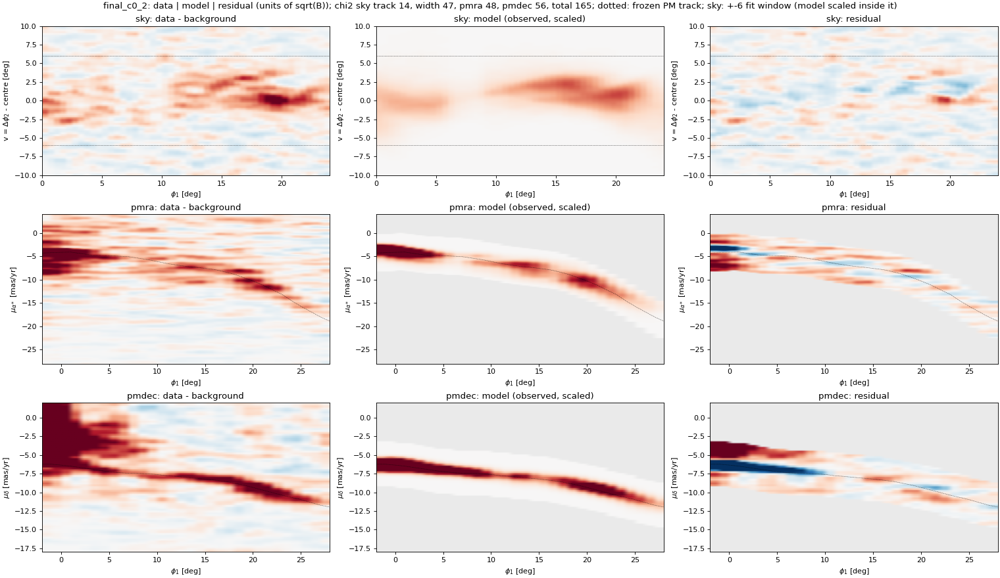
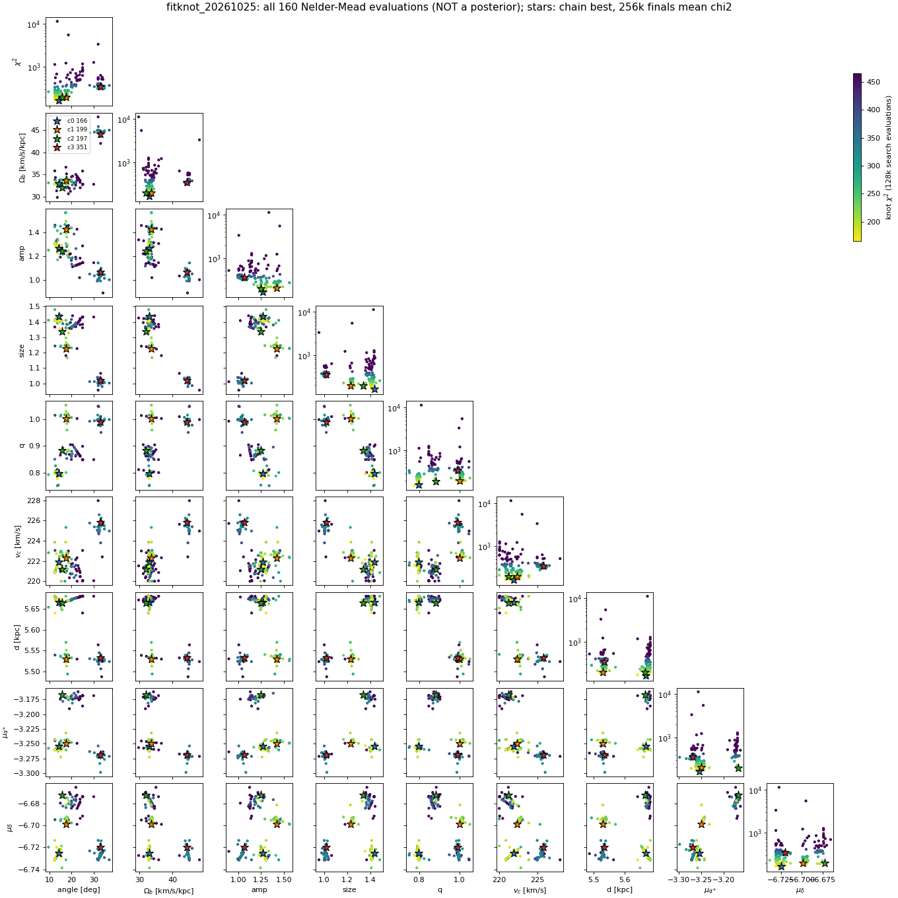

# oCen_stream: the Omega Centauri stream and the Milky Way bar

**Goal.** Constrain the Milky Way bar (pattern speed Ωb, angle, amplitude, size), the halo flattening q, the circular
speed vc and the cluster's distance and proper motion by fitting particle-spray models of the Omega Centauri tidal stream
(STREAMFINDER stream 54, Fimbulthul; [Ibata et al. 2024](https://ui.adsabs.harvard.edu/abs/2024ApJ...967...89I)) in Gaia DR3.

This work started inside [oCen_dm](https://vasilybelokurov.github.io/ocen_dm/) and moved here on 2026-10-25 with its history.
The pages under *History* and *Reviews* describe the state before that date.

## Status (2026-10-25)

- **Data vector (25 numbers).** Sky: one-Gaussian fits in seven 3° windows along φ1 (track and width; no branch cut;
  φ1 6–9° dropped). Proper motions: spline tracks of μα* and μδ at their knots (6 and 5), with full
  covariance. Errors are used as measured.
- **Score.** Each model is measured exactly like the data (same masks, same fits); χ² of data minus model with data and
  model (bootstrap) errors; no nuisance terms.
- **Rescoring of 2,369 stored models.** The best scores χ² = 166; the best model without a bar scores 598.
- **Free 9-parameter fit** (Nelder–Mead, 4 chains, 40 steps each). Best: χ² = 165.5 ± 1.4 (four 256k-particle seeds) at
  angle 14°, Ωb 33 km/s/kpc, amplitude 1.27, size 1.44, q 0.80, vc 222 km/s, distance 5.67 kpc.
  The search did not improve on its starting point. The three good chains agree on Ωb ≈ 32–34 and angle ≈ 14–18°;
  q, distance and size are not pinned down; vc and distance sit at their range limits. The chains stayed near their
  starts, so this is not a posterior.
- **Remaining misfits.** The model stream is too wide at φ1 0–3° and 21–24°; μα* and μδ miss at the end knots.

## How to navigate

- **[Data](kb/data/tails_streams.md)**: the stream sample, Gaia errors, derived geometry and caches; [potentials and frames](kb/data/potentials.md).
- **[Status up to 2026-10-18](kb/stream_status.md)**, [likelihood versions](kb/models/stream_likelihood_versions.md),
  [results index](kb/models/stream_results_index.md).
- **[Reviews](reviews/index.md)** and **[literature](kb/literature.md)**.
