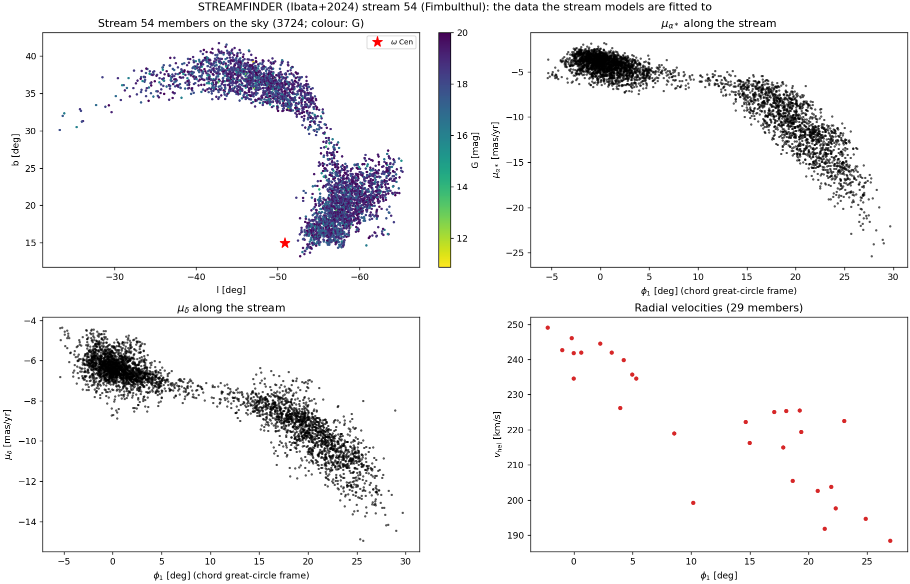

# Stream data

The stream-54 inputs (S1–S7), copied from the oCen_dm data page on 2026-10-25; the shorthands follow that page ([oCen_dm data products](https://vasilybelokurov.github.io/ocen_dm/kb/data/)). The cluster periphery and tail datasets (T1–T4) stay in oCen_dm.

## Figures

*STREAMFINDER (Ibata+2024) stream 54: 3,724 members on the sky (colour: G), of which the stream models are fitted to the 3,681 inside the `load_data` cut (b > 15°, −75° < l < −20°; `bin/streams/spray_bar_grid2.py`); proper motions along the stream in the chord great-circle frame φ1, showing the steepening beyond φ1 ≈ 15° (the "knee"); and the 29 radial velocities.*

## S1. STREAMFINDER Gaia DR3 atlas (Ibata et al. 2024): the stream-54 sample

- **Source** (`configs/data.yaml:50–61`). ApJ 967, 89; arXiv:2311.17202; ADS 2024ApJ...967...89I. Table 1 is the MRT `apjad382dt1_mrt.txt` from content.cld.iop.org (not on VizieR). Fetched 2026-10-08; the MRT sha256 is `76742daa…`.
- **Files.**
  - `CAT/streamfinder_ibata2024_dr3_mrt.txt` (2,432,198 B): the registered `path`.
  - `CAT/streamfinder_ibata2024_dr3.fits` (2,364,480 B): what the code reads. No conversion script and no checksum exist for it.
- **Contents.** 24,540 rows.
  - Stream 54 (Fimbulthul): 3,724 stars, 29 with VHel.
  - Stream 55 (Fimbulthul-S): 1,734 stars, 25 with VHel.
  - `e_VHel = 300` means null.
- **Loader.** `bin/streams/spray_bar_grid2.py:24–32 load_data`.
  - Keeps Stream == 54 with b > 15° and −75° < l < −20°: 3,681 of the 3,724 members.
  - Sets VHel to NaN unless `e_VHel < 300`.
  - Attaches S2 errors and correlations.
  - About 20 scripts import it (`fit_bar_ocen.py`, `grid4_common.py` → grid4, `fit_lmc_ocen`, `rescore_*` and others). About 15 more read the FITS directly with the same cut.
- **Scoring.** `src/ocen_dm/streams/score.py`.
- **Restrictions.**
  - Track-only (STREAMFINDER selection, as for T4).
  - Ibata+2024 exclude stream 54 from their own potential fit (the project journal).
  - Member parallaxes are biased by +0.063 mas relative to the cluster (the project journal).
- **Status.** c.

## S2. Gaia DR3 errors and correlations for stream-54/55 members

- **Product.** `results/plot_data/stream5455_gaia_errors.npz` (168,341 B; 5,458 rows). Keys `source_id`, `pmra_error`, `pmdec_error`, `pmra_pmdec_corr`, `parallax_error`, `ruwe`, `g`.
- **Builder.** **None in the repo**: it was an ad hoc WSDB `source_id` join, recorded only in the project journal.
- **Consumers.** Every `load_data` user; `measure_track.py:21`.
- **Status.** c. This is a reproducibility gap.

## S3. STREAMFINDER EDR3 (Ibata et al. 2021)

- **Source.** ApJ 914, 123; arXiv:2012.05245; VizieR `J/ApJ/914/123/table1`. FITS sha256 `d5cdffa6…` (`configs/data.yaml:40–49`).
- **File.** `CAT/streamfinder_ibata2021_edr3.fits` (457,920 B; 5,960 rows; stream 16 = Fimbulthul, 1,006 stars).
- **Consumers.** None.
- **Status.** e. It is superseded by S1 (`data.yaml:58`).

## S4. Derived stream-54 geometry

All files are in `results/plot_data`.

| File | Builder | Consumers |
|---|---|---|
| `stream54_track.json` | `bin/streams/measure_track.py:39`, using `streams/track.py` | spray-grid scripts, `build_stream_path.py`, `validate_spray.py`, untracked `check_stream_coordinate.py` |
| `stream54_path.json` | `bin/streams/build_stream_path.py:16` | `build_gc_frame.py`, `knee_spread_and_frame.py`, `rescore_conditional.py` |
| `stream54_gc_frame.json` and `stream54_gc_frame_chord.json` | `bin/streams/build_gc_frame.py:18` (`--chord`) | the chord frame is current: grid4, `fit_bar_ocen`, `parallax_check`, `m5_independent_selection`, `rescore_conditional` and others |
| `stream54_cmd_distance.json` | `bin/streams/stream54_cmd_distance.py` | — |

The cluster mass profile used by the spray is `results/nbody/A_nodm/model_profiles.json`, an internal product. Status: c.

## S5–S7. WSDB caches in the stream project

- **S5, Gaia XP [M/H].**
  - Products: `results/plot_data/stream_xp_metallicity_members.npz` (74,969 B; 5,481 rows) and `ocen_members_andrae.npz` (34,416 B; 3,993 rows).
  - Built by q3c joins to `koposov.andrae2023_v21_table1` on WSDB (the project journal). **There is no builder script.**
  - Consumer: `bin/streams/plot_stream_xp_metallicity.py`.
  - Status: d. The project journal calls the result inconclusive.
  - Paper: Andrae et al. 2023, ApJS 267, 8, [2023ApJS..267....8A](https://ui.adsabs.harvard.edu/abs/2023ApJS..267....8A/abstract) (resolved in ADS, `docs/kb/literature.json`).
  - Large local XP/Andrae files in `CAT` (`gaia_xp_andrae_parallax01.fits` 1.89 GB, `gc_members_vasiliev_XP.fits` 280 MB, `xp_rvs_andrae_*`) are not referenced by repo code.
- **S6, Gaia DR3 rotation pull.**
  - Builder: `bin/streams/measure_gaia_rotation.py:18–25`. Cuts: within 0.6°, RUWE < 1.3, PM errors < 0.15 mas/yr, PM window ±2 mas/yr.
  - Products: `results/plot_data/gaia_dr3_ocen_rotation_pull.npz` (526,559 B; 19,062 rows) and `gaia_dr3_ocen_rotation.json`.
  - Consumer: `bin/streams/fit_spin.py:43` (spin-tracer fit).
  - Status: c.
- **S7, knee box and stream-54 parallax.**
  - `results/streams/m5_gaia_knee.npz` (242 MB), a WSDB cache written by `bin/streams/m5_independent_selection.py:33–48`, was deleted in the 2026-10-13 clean-up. The script re-queries WSDB when the cache is absent. Status: d.
  - `results/streams/stream54_parallax.npz` (75,847 B), built by `bin/streams/parallax_check.py:22`. Status: d.

